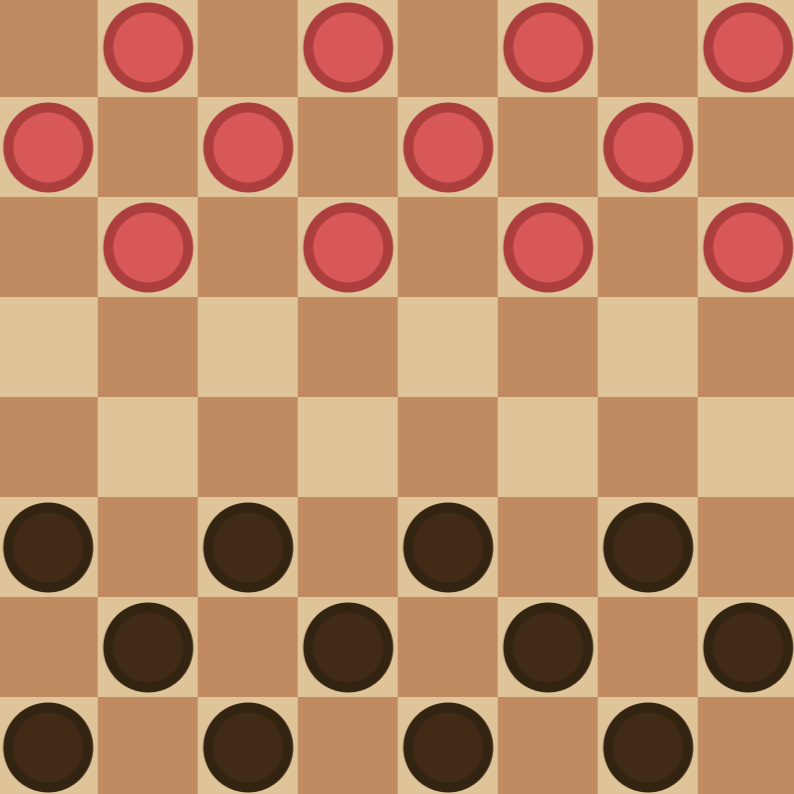

## Damas by NathanSDC

Um jogo de damas simples, atualmente com dois modos de jogo e regras básicas de movimentação e captura.

## v0.0.1-alpha [LATEST]

Possui dois modos de jogo: 
   - Contra player
      + Modo de jogo em turnos, após a jogada de um player muda automáticamente a vez para o outro player.
      + Recomendavel que se jogue com um amigo!
   - Contra IA
      + Modo de jogo em turnos, após a jogada do player o algoritmo calcula uma jogada e a executa em aproximadamente 2 segundos.
      + O algoritmo tem 50% de chance de calcular uma melhor jogada possivel, ou então jogar uma peça aleatóriamente.

## Em breve:

   - Captura de múltiplas peças (combo).
   - Opção de alterar a dificuldade do Algoritimo do modo IA.
   - Opção de alterar as regras de movimentação no tabuleiro (Tornar dama obrigatóriamente, etc).
   - Opção de alterar as regras de captura tanto para peças comuns ou para damas (Captura obrigatória, etc).
